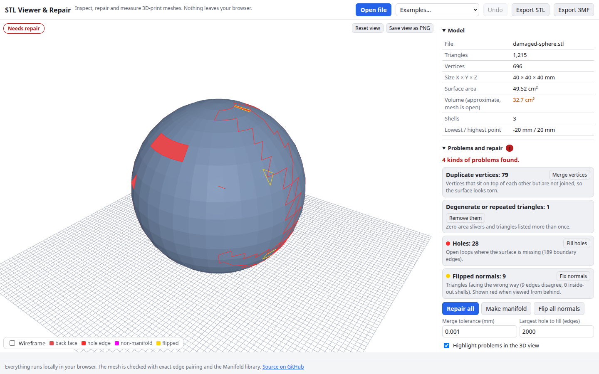

# STL Viewer & Repair

Open an STL, OBJ or 3MF file and see at once whether it is a sound solid. The tool finds holes, flipped normals, duplicate vertices and non-manifold edges, highlights them in 3D, and repairs them with [Manifold](https://github.com/elalish/manifold). You can also measure, cut a cross-section, scale, rotate, and export a clean STL or 3MF. Everything runs in your browser.

**Try it: [hermes98761234.github.io/stl-viewer-repair](https://hermes98761234.github.io/stl-viewer-repair/)**

[](https://github.com/hermes98761234/stl-viewer-repair/actions/workflows/deploy.yml)



## Features

- **Load STL (binary and ASCII), OBJ and 3MF**, by file picker or drag and drop. Built-in damaged examples show the tool at work on first load.
- **Statistics:** triangles, vertices, bounding box, surface area, signed volume, shell count and genus.
- **Diagnosis:** open holes, flipped or inconsistent normals, inside-out shells, non-manifold edges, duplicate vertices, degenerate and repeated triangles. Problems are outlined in the 3D view, and faces seen from behind show red.
- **Repair:** merge vertices within a tolerance, remove degenerate and duplicate triangles, fix normals, fill holes, and make the mesh manifold. Or press **Repair all**. Each step can be undone, and a log says what changed.
- **Cross-section** along X, Y or Z with live area and outline length, and an optional cutaway.
- **Measure** the distance between two points picked on the model.
- **Scale, rotate, mirror and centre on the bed.** One click converts inches to mm.
- **Export** binary STL or 3MF, or save the view as PNG.
- **English or Ukrainian, light, dark or system theme, millimetres or inches.** Settings are remembered. Nothing is uploaded and there is no tracking.

## How it works

The model is an indexed triangle mesh. The analysis counts how many triangles use each edge, and in which direction. A solid needs every edge used by exactly two triangles, one in each direction. An edge used once is a hole boundary, three or more times is non-manifold, and two triangles that run the same way are a flipped pair. The signed volume (divergence theorem) is negative for an inside-out shell.

Repair runs in a Web Worker: vertices are merged on a spatial hash, normals are made consistent by flood fill over shared edges and each patch is turned outward by its volume, and holes are ear-clipped in the best-fit plane of their boundary loop. Stray triangles on non-manifold edges are dropped, keeping the ones that belong to the main surface. The final mesh goes through Manifold (`manifold-3d`, single-threaded WASM bundled with the site, so it needs no special headers) which accepts only valid solids, and gives the independent volume, area and genus shown in the panel.

Cross-sections cut every triangle against the plane and chain the segments into closed outlines. Their signed areas add up, so a hollow part subtracts its cavity.

Limits: very large meshes (millions of triangles) are slow, holes are filled with flat patches (no smoothing), and 3MF import reads mesh objects only (build transforms and materials are ignored).

## Quick start

You need [Node.js](https://nodejs.org/) 22.

```bash
git clone https://github.com/hermes98761234/stl-viewer-repair.git
cd stl-viewer-repair
npm install
npm run dev       # http://localhost:5173
npm test          # geometry, repair, file format and i18n tests
npm run build     # static site in dist/
```

## License

MIT
